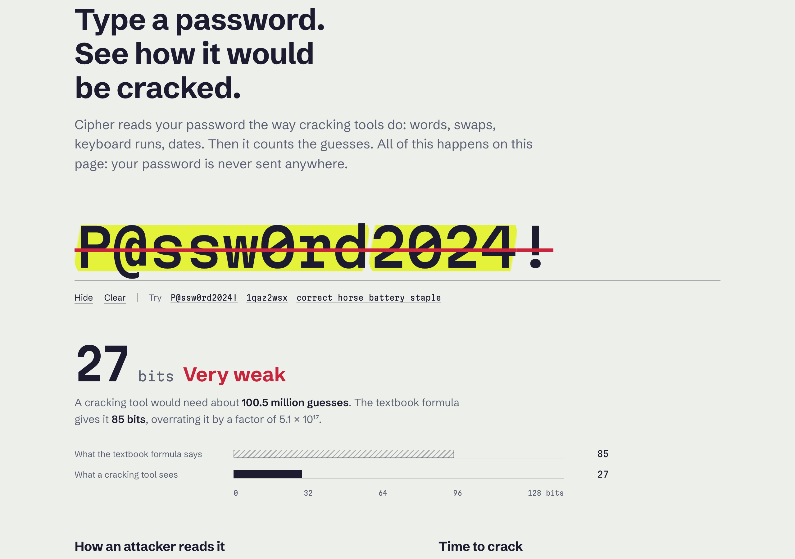

# Cipher

[](https://github.com/Wizminar/Cipher/actions/workflows/ci.yml)


**See how a password would actually be cracked.** Cipher reads a password the way cracking tools do (leaked-password lists, dictionary words, symbol swaps, keyboard walks, dates, repeats), estimates the real number of guesses, and checks it against 900M+ breached passwords, all without the password leaving the browser.

**Live:** https://cipher.mohitupawar.com

<picture>
  <source media="(prefers-color-scheme: dark)" srcset=".github/preview-dark.png">
  
</picture>

| | Textbook formula | Cipher's estimate |
|---|---|---|
| `P@ssw0rd2024!` | 85 bits, "strong" | **27 bits**, guessed in ~100 million tries |
| `1qaz2wsx` | 41 bits | **9 bits**, on every cracking list |
| `correct horse battery staple` | 165 bits | **91 bits**, genuinely strong |

## Highlights

- **A strength engine written from scratch:** pattern matchers plus a dynamic-programming search over how a password can be split up, the approach behind Dropbox's zxcvbn.
- **Privacy by design:** the password never leaves the browser, and the breach check uses k-anonymity. Building it uncovered (and fixed) a subtle leak: checking as you type gives the password away through related hash prefixes.
- **Security engineering:** a strict CSP with no `unsafe-*`, a hashed inline snippet, locked-down headers, no third-party requests, and deploys that publish only the site files.
- **Tested:** 70 tests across the engine, breach check, generator, UI and security config, run in CI on every push.
- **Small and dependency-free:** three files, no framework, no build step, and it works when `index.html` is opened from disk.

## What it does

- **Pattern-aware strength estimation.** A from-scratch engine in the spirit of Dropbox's zxcvbn. Matchers find dictionary words (plain, reversed, l33t-substituted, with capitalisation variants), QWERTY keyboard walks, character sequences, repeated chunks, years and dates. A dynamic-programming search then finds the cheapest way to split the password into those pieces.
- **"How an attacker reads it."** The password is marked up live: every guessable piece is highlighted, with what it is and how many guesses it costs.
- **Crack time under four threat models.** Rate-limited login, unthrottled login, stolen bcrypt database and stolen fast-hash database, because the website's storage choices matter as much as the password.
- **Private breach check (k-anonymity).** SHA-1 in the browser, with only a 5-character prefix sent to the Have I Been Pwned range API. Response padding is on, matching happens locally, and the page shows exactly what was sent and what came back. It runs only when you ask (see the threat model for why).
- **Generator.** Diceware-style passphrases from the EFF large wordlist, or random characters, using `crypto.getRandomValues` with rejection sampling so there's no modulo bias.
- **Just three files.** `index.html`, `style.css` and `script.js`, with no build step to run the site. Open `index.html` straight from disk and it works.

## How the estimate works

Every matcher returns candidate pieces with a guess count:

| Pattern | Guesses |
|---|---|
| Dictionary word | rank in list × capitalisation variants × l33t variants (× 2 if reversed) |
| Keyboard walk | Σ over lengths and turns of C(i−1, j−1) × keys × avg-degree^j, × shift variants |
| Sequence (`abc`, `9753`) | base × length (base 4 for obvious starts, 10 digits, 26 letters, × 2 descending) |
| Repeat (`abcabc`) | guesses for the base × repeat count |
| Year / date | years from 2026 (min 20), × 365 for full dates |
| Anything else | pool size ^ length (brute force) |

The optimal split of a password into *k* pieces minimises

```
guesses = k! × Π(piece guesses) + 10000^(k−1)
```

`k!` accounts for piece ordering, and the additive term stops the optimiser from favouring many tiny cheap pieces. Bits = log₂(guesses).

## Architecture

The website is three files in the repo root:

```
index.html     page markup, plus one tiny hashed snippet that applies the saved theme before first paint
style.css      design tokens, light and dark themes, fonts embedded as data URIs
script.js      all the logic, as one plain script in ten sections:
                 1. math helpers            6. analysis: verdicts, descriptions, advice
                 2. QWERTY keyboard graph   7. breach check (k-anonymity)
                 3. pattern matchers        8. password / passphrase generator
                 4. minimum-guess search    9. page controller
                 5. crack-time scenarios   10. word lists (generated)
```

Development files, which are never deployed:

```
tests/                  Vitest suites: engine, breach + generator, UI (happy-dom), security
scripts/raw/            source word lists
scripts/build-data.mjs  rewrites the word-list section of script.js from scripts/raw
scripts/build.mjs       copies the three site files into dist/
scripts/serve-prod.mjs  serves dist/ with the netlify.toml headers, for testing the CSP
netlify.toml            deploy settings and security headers
```

`script.js` wraps everything in one function, so nothing leaks into the page's global scope except `window.Cipher`, which the tests use. No framework, no bundler, no runtime dependencies. Vitest and happy-dom are the only dev dependencies.

## Security and threat model

- **What leaves the browser:** a 5-hex-character SHA-1 prefix, sent to `api.pwnedpasswords.com` without cookies or a referrer, and only when the user presses *Check breaches* or Enter. About a million passwords share any given prefix, and the `Add-Padding` header hides the true size of the response.
- **What doesn't:** the password, its full hash, and the match result. There's no analytics, no backend, and no third-party CDN: the fonts are embedded in `style.css`, so loading the page tells no one else you visited.
- **Why there's no "check as you type":** an earlier version did this, and it broke k-anonymity. Each pause sent the prefix for a slightly longer string (`d`, `dr`, `dra`…). Anyone watching could try each possible next character, keep the one whose hash matched the next prefix, and rebuild the password one character at a time. Checks are now explicit, and a test fails if typing ever triggers a request.
- **Headers** (in `netlify.toml`): a strict Content Security Policy (`default-src 'none'`, everything else `'self'`, `connect-src` adds only HIBP, `frame-ancestors 'none'`), HSTS, `Referrer-Policy: no-referrer`, a locked-down `Permissions-Policy`, COOP/CORP and `nosniff`. The only inline code is the one-line theme snippet, which the CSP allows by its SHA-256 hash rather than with `unsafe-inline`. A test recomputes that hash, so editing the snippet without updating the CSP fails the build.
- **Deployment** publishes only `dist/` (the three site files, copied by `npm run build`), so tests, scripts and package files are never served.
- **Responses are validated:** malformed lines from the API are ignored, and results that come back after the password changed are discarded.
- **Input handling:** the password field is a `textarea` overlaid on a rendered mirror, so password managers don't offer to save the audited value. All rendering uses `textContent`, never `innerHTML`.
- **SHA-1** is used only because the HIBP API requires it. It's a lookup key, not password storage.

## What the tests cover

- **Engine:** every matcher, the minimum-guess search, the naive formula, edge cases (128-character worst cases under 250 ms, emoji and non-Latin text, empty input), and that verdicts rise with strength.
- **Breach + generator:** SHA-1 output, that only the prefix is sent with padding on, malformed-response handling, rejection sampling (including a rigged RNG), uniformity, and EFF passphrases.
- **UI** (real `index.html` + `script.js` in happy-dom): rendering, caret alignment, hide mode leaking nothing, hostile input rendered as text, no network while typing, stale results dropped, offline errors.
- **Security:** the CSP has no `unsafe-*` and its hash matches the theme snippet, the page loads only `style.css` and `script.js`, there's no `innerHTML`/`eval`, only the breach section makes requests, `script.js` stays a plain script that exposes only `window.Cipher`, and `dist/` contains exactly the three site files.

## Limitations

- The lists are modest: ~10k common passwords, ~9.5k English words and ~4.9k mostly Western first names. Real attackers have far bigger lists and personal context, so scores are an upper bound.
- Attack rates are round numbers for realistic setups, not benchmarks.

## Run locally

```bash
npm install
npm test                          # 70 tests: engine, breach, generator, UI, security
npm run dev                       # serves on http://localhost:5173
npm run build && node scripts/serve-prod.mjs   # dist/ with the real production headers
```

You can also just open `index.html` in a browser; no server is needed. After changing anything in `scripts/raw/`, run `npm run build:data` to update the word lists in `script.js`.

## Deploy

Netlify reads `netlify.toml`: it runs `npm run build`, publishes only `dist/` (the three site files), and applies the security headers. Any static host works if you copy `index.html`, `style.css` and `script.js` and set the same headers.

## Credits

Approach inspired by [zxcvbn](https://github.com/dropbox/zxcvbn) (Wheeler, USENIX Security 2016). Word lists: [SecLists](https://github.com/danielmiessler/SecLists), [google-10000-english](https://github.com/first20hours/google-10000-english), [EFF large wordlist](https://www.eff.org/dice). Breach data: [Have I Been Pwned](https://haveibeenpwned.com/Passwords). Fonts: Martian Mono (Evil Martians) and Schibsted Grotesk (Schibsted), both under the SIL Open Font License 1.1.

Built by [Mohit Pawar](https://mohitupawar.com/).
